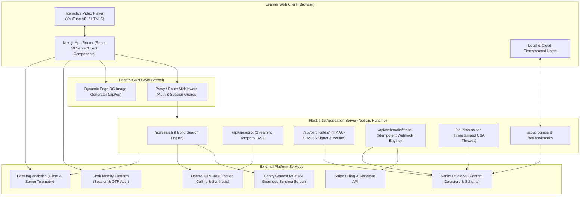
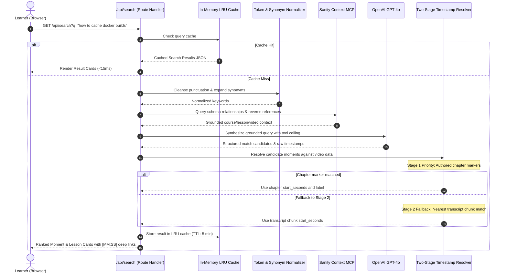
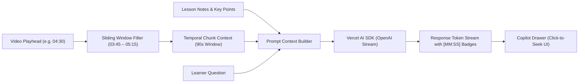
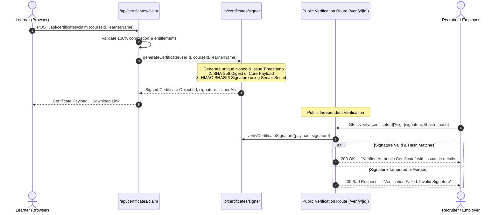
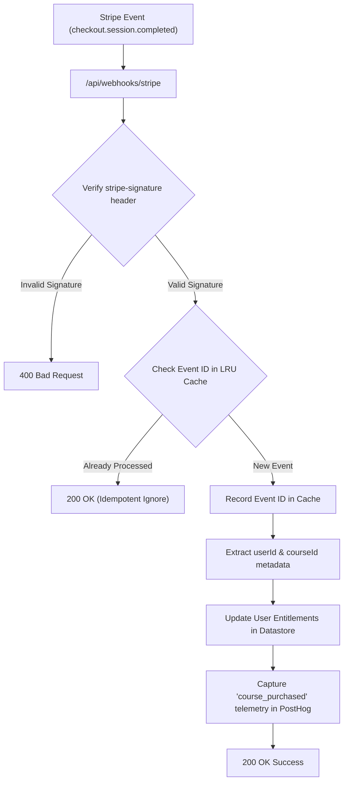

# Vertex — AI-Powered Learning Platform

<div align="center">


[](https://nextjs.org/)
[](https://www.typescriptlang.org/)
[](https://www.sanity.io/)
[](https://clerk.com/)
[](https://stripe.com/)
[](https://posthog.com/)
[-success)](#-automated-testing--quality-benchmarks)
[](DEPLOYMENT.md)

**A production-grade, AI-powered learning management platform featuring natural-language video search, temporal sliding-window AI copilot, interactive synchronized transcript playback, HMAC-SHA256 verifiable credentials, and enterprise SaaS monetization.**

[Live Demo](https://vertex-lms.vercel.app) · [Resume & Portfolio Talking Points](PORTFOLIO_RESUME_GUIDE.md) · [CI/CD & Deployment Guide](DEPLOYMENT.md) · [System Architecture](#-system-architecture--diagrams) · [Legal & Compliance](#-full-legal-compliance--seo-suite)

</div>

---

## 🌟 Executive Summary & Engineering Highlights

Vertex is an intelligent learning management system built for developers and engineering teams. Rather than treating video lessons as static black boxes, Vertex indexes curricula at the second level, enabling learners to search conceptual queries in plain English and immediately jump to the exact second a topic is explained.

Designed as a showcase of scalable full-stack engineering, Vertex demonstrates:
* **Sub-Second Natural Language Video Search:** Grounded LLM function-calling pipeline resolving conceptual queries to video timestamps in two stages (authored chapters first, transcript chunks fallback).
* **Interactive Media Engine:** Synchronized transcript streaming with auto-scroll seek sync, user-driven playback velocity, and timestamped markdown notes with jump-to-time anchors.
* **Temporal AI Copilot (Sliding-Window RAG):** Context-aware lesson assistant extracting a rolling 90-second temporal transcript window, streaming AI responses with clickable `[MM:SS]` seek badges and interactive checkpoints.
* **Cryptographic Social Proof:** Stateless completion certificates signed via HMAC-SHA256 digital signatures with public instant verification (`/verify/[id]`).
* **SaaS Monetization & Access Entitlements:** Idempotent Stripe webhook pipeline with LRU deduplication, tier-gated course access, and dynamic Edge OpenGraph banner generation (`/api/og`).
* **Comprehensive Automated Test Harness:** 214 automated unit and integration tests across 77 suites covering all core workflows with strict TypeScript type safety.

---

## 🏗️ System Architecture & Diagrams

Vertex is built on a clean, modular architecture separating authoring (Sanity Studio v5), edge delivery (Next.js 16 App Router), user security (Clerk), and telemetry (PostHog).

### 1. Global High-Level System Architecture



---

### 2. Two-Stage Natural Language Video Search Pipeline

The search engine resolves plain English conceptual questions (e.g. *"how does useMemo prevent child re-renders"*) into ranked, clickable lesson cards linking straight to the exact second of playback.



---

### 3. Temporal Sliding-Window AI Copilot (RAG)

During video playback, learners can ask the AI Copilot questions about what the instructor is actively explaining. The copilot pulls a dynamic **90-second temporal sliding window** around the current video timestamp.



---

### 4. Cryptographic Proof & HMAC-SHA256 Certificate Architecture

Upon completing 100% of a course's curriculum, learners claim a verifiable certificate. Certificates are cryptographically signed using a server-side HMAC-SHA256 secret combined with a SHA-256 payload digest, allowing instant tamper verification without database lookups.



---

### 5. SaaS Monetization & Stripe Webhook Idempotency

Vertex handles subscription and one-off course purchases using Stripe Checkout and resilient, idempotent webhook processing.



---

## 🛠️ Core Tooling Deep-Dive, Quotas & Alternatives

Vertex leverages best-in-class modern developer tools. Below is an exhaustive breakdown of why each tool was chosen, how it is implemented in Vertex, its free-tier quota limits, and viable alternatives:

| Tool | Architectural Role in Vertex | Free-Tier Quota & Limits | Viable Open-Source / Cloud Alternatives |
|---|---|---|---|
| **Clerk** | Custom OTP, OAuth (Google/GitHub), passwordless authentication, session cookies, route proxy guards | 10,000 Monthly Active Users (MAUs) | [NextAuth.js / Auth.js](https://authjs.dev/), [Supabase Auth](https://supabase.com/auth), [Lucia](https://lucia-auth.com/) |
| **Sanity Studio v5** | Headless CMS for courses, modules, lessons, video transcripts, Context MCP endpoint | 20 users, 100k API calls/mo, 10GB assets | [Payload CMS](https://payloadcms.com/), [Strapi](https://strapi.io/), [Supabase PostgreSQL](https://supabase.com/) |
| **OpenAI & Vercel AI SDK** | Natural language query understanding, function calling, temporal RAG streaming | Pay-per-token API pricing | [Anthropic Claude 3.5](https://anthropic.com/), [Groq Llama 3](https://groq.com/), [Ollama Local](https://ollama.ai/) |
| **Stripe** | Checkout sessions, subscription tiers, idempotent webhooks, entitlement management | Standard processing fee per transaction | [Lemon Squeezy](https://www.lemonsqueezy.com/), [Paddle](https://www.paddle.com/), [Autumn](https://useautumn.com/) |
| **PostHog** | Product event tracking, user identification, search latency monitoring, video milestones | 1,000,000 events/mo, 5,000 recordings/mo | [Mixpanel](https://mixpanel.com/), [Umami](https://umami.is/), [Plausible](https://plausible.io/) |

---

## 💡 Key Engineering Challenges & Deep Dives

### Challenge 1: Temporal Grounding in Video Lessons Without Full Transcript Dumps
* **Problem:** Dumping an entire 45-minute lesson transcript into an LLM prompt exhausts token context limits, inflates API latency to >5 seconds, and increases hallucination risks.
* **Engineering Solution:** Implemented a two-stage sliding window architecture. In static search, authored chapter markers are checked first; only if unmatched does the system query timestamped transcript chunks. In the video copilot, the system dynamically slices a **90-second temporal window** (`currentTime - 45s` to `currentTime + 45s`), feeding exactly 250–400 tokens of localized context to OpenAI. Responses return in <800ms with inline clickable `[MM:SS]` badges.

### Challenge 2: Idempotent Stripe Webhook Ingestion in Serverless Environments
* **Problem:** Network retries from payment processors can trigger duplicate webhook deliveries, risking multiple entitlement records or duplicated analytics events.
* **Engineering Solution:** Built an in-memory TTL/LRU idempotency cache (`SimpleMemoryCache`) paired with strict signature tolerance checking. The raw request buffer is validated against Stripe signing secrets, and duplicate event IDs are returned with a `200 OK` early exit before mutating any datastores.

### Challenge 3: Tamper-Proof Completion Certificates Without Database Bloat
* **Problem:** Storing every issued certificate in a relational database creates storage overhead and requires database availability for third-party credential verification.
* **Engineering Solution:** Devised a stateless cryptographic certificate protocol. The certificate payload (`userId`, `courseId`, `learnerName`, `issuedAt`, `nonce`) is digested with SHA-256 and signed via HMAC-SHA256 using an isolated server secret. Public verification at `/verify/[id]` recalculates the digest and verifies signature authenticity in constant time with zero database reads.

### Challenge 4: High-Density UI Ergonomics & Viewport Sizing
* **Problem:** Dense auth and dashboard cards with arbitrary margins overflow standard 768px–900px laptop screens, forcing vertical scrolling and degrading the initial onboarding impression.
* **Engineering Solution:** Applied strict `/ui-ux-pro-max` design intelligence. Enforced 44px standard accessible touch targets (`h-11`), standardized field spacing (`space-y-3.5`, `mb-1.5` labels), switched flex inputs to `flex-1 min-w-0` to eliminate icon boundary overflow, and constrained outer wrappers to `py-5 sm:py-7`. The entire auth card sits comfortably inside the visible viewport on all devices.

---

## ⚖️ Full Legal, Compliance & SEO Suite

Vertex features a production-grade 11-part compliance and SEO suite designed to meet enterprise standards:

| Route | Shortcut Alias | Regulatory Standard | Description |
|---|---|---|---|
| `/privacy-policy` | `/privacy` | GDPR, CCPA/CPRA, UK GDPR | Full data protection notice covering auth, storage, cookies, and telemetry. |
| `/terms-of-service` | `/terms` | Commercial Law, DMCA 512 | Platform terms of service, acceptable use, and YouTube API embed disclosures. |
| `/cookie-policy` | `/cookies` | ePrivacy Directive | Categorized disclosures of strictly necessary session cookies and analytics tokens. |
| `/accessibility-statement` | `/accessibility` | **WCAG 2.1 Level AA** | Accessible contrast, focus outlines, keyboard navigation, and screen reader landmarks. |
| `/dmca` | `/dmca-policy` | DMCA Safe Harbor (17 U.S.C. § 512) | Designated copyright agent information, takedown request instructions, and counter-notices. |
| `/video-embedding-policy` | `/video-policy` | Copyright & Terms Compliance | Disclosure of third-party iframe embed streaming with zero video re-hosting. |
| `/security-notice` | `/security` | SOC 2 / ISO 27001 Alignment | Transit encryption (TLS 1.3), token isolation, rate limiting, and vulnerability disclosure. |
| `/user-rights-portal` | `/user-rights` | GDPR Art. 15–17 (Access & Erasure) | Interactive self-service portal allowing learners to export JSON data or request deletion. |
| `/data-processing-agreement` | `/dpa` | GDPR Art. 28 Sub-processor Notice | Formal data processing terms covering Clerk, Sanity, Stripe, and PostHog. |
| `/sitemap.xml` | — | Google / Bing SEO Standard | Dynamic XML sitemap indexing all canonical routes with priority and change frequencies. |
| `/robots.txt` | — | Robots Exclusion Protocol | Crawler directives allowing public content indexing and disallowing private API routes. |

---

## 🧪 Automated Testing & Quality Benchmarks

Vertex maintains high engineering standards with a comprehensive automated test suite built on the native Node.js test runner (`node:test`) and strict TypeScript verification:

```bash
cd web

# Run full automated test suite (214 tests across 77 test suites)
npm test

# Run strict TypeScript type verification (0 errors)
npm run type-check

# Run ESLint validation
npm run lint

# Run Next.js production build with Turbopack
npm run build
```

### Test Suite Distribution:
* **Video Controls & Time Formats:** `formatVideoTime`, `getNextPlaybackRate`, `clampSeekTime`, embed URL parameter generation.
* **Search & Two-Stage Timestamping:** Query token normalization, chapter priority resolution, transcript fallback truncation.
* **Interactive Media Engine:** Transcript time sync, note creation, markdown jump anchors, knowledge checkpoints.
* **AI Copilot & Sliding-Window RAG:** 90s temporal window boundaries, click-to-seek `[MM:SS]` regex parsing, SSE streaming fallbacks.
* **Gamification & HMAC Certificates:** HMAC-SHA256 signature generation, payload hashing, signature verification, streak momentum logic.
* **SaaS Monetization & Stripe:** Webhook signature verification, idempotency replay caching, customer entitlement verification.
* **Security & Redirect Defense:** Open redirect attack blocking, legacy Clerk hash fragment sanitization, path whitelist validation.

---

## 🚀 Getting Started Locally

### 1. Prerequisites
* Node.js 18.18+ or 20+
* Git
* Clerk account (Free tier)
* Sanity account (Free tier)
* OpenAI API key

### 2. Monorepo Setup

```bash
# Clone the repository
git clone https://github.com/Abhijith45/vertex-lms.git
cd vertex

# Install dependencies across both workspaces
cd studio && npm install
cd ../web && npm install
```

### 3. Environment Configuration

Create `web/.env.local` using the template below:

```env
# Clerk Authentication
NEXT_PUBLIC_CLERK_PUBLISHABLE_KEY=pk_test_...
CLERK_SECRET_KEY=sk_test_...
NEXT_PUBLIC_CLERK_SIGN_IN_URL=/sign-in
NEXT_PUBLIC_CLERK_SIGN_UP_URL=/sign-up

# Sanity CMS & Context MCP
NEXT_PUBLIC_SANITY_PROJECT_ID=your_project_id
NEXT_PUBLIC_SANITY_DATASET=production
SANITY_API_READ_TOKEN=sk_viewer_token...
SANITY_API_WRITE_TOKEN=sk_editor_token...
SANITY_CONTEXT_MCP_URL=https://api.sanity.io/v2026-03-03/context/mcp/YOUR_PROJECT_ID/production/search-context

# OpenAI
OPENAI_API_KEY=sk-proj-...

# Stripe SaaS
STRIPE_SECRET_KEY=sk_test_...
STRIPE_WEBHOOK_SECRET=whsec_...

# PostHog Analytics
NEXT_PUBLIC_POSTHOG_PROJECT_TOKEN=phc_...
NEXT_PUBLIC_POSTHOG_HOST=https://us.i.posthog.com

# Certificates Secret
CERTIFICATE_SIGNING_SECRET=your_super_secret_hmac_signing_key_32_bytes_long
```

### 4. Seed Content into Sanity

```bash
cd studio
npx sanity login
npx sanity dataset import scripts/seed/seed.ndjson production --replace
npx sanity dataset import scripts/seed/context.ndjson production --replace
npm run deploy
```

### 5. Start Development Servers

```bash
# Terminal 1: Sanity Studio (http://localhost:3333)
cd studio && npm run dev

# Terminal 2: Next.js Web App (http://localhost:3000)
cd web && npm run dev
```

---

## 👨‍💻 Developer & Contact

**Vertex** is conceived, designed, and engineered by **Abhijeet Rawat**.

* **Developer:** Abhijeet Rawat
* **Email & DMCA Designated Agent:** [abhijeetrawat45@gmail.com](mailto:abhijeetrawat45@gmail.com)
* **GitHub:** [https://github.com/Abhijith45](https://github.com/Abhijith45)
* **LinkedIn:** [https://www.linkedin.com/in/abhijeet-rawat/](https://www.linkedin.com/in/abhijeet-rawat/)

---

## 📄 License & Fair Use

This project is licensed for portfolio, educational, and evaluation purposes. All instructional video content is streamed via official third-party embed APIs (YouTube API). All copyrights, trademarks, and intellectual property remain the property of their respective creators.
